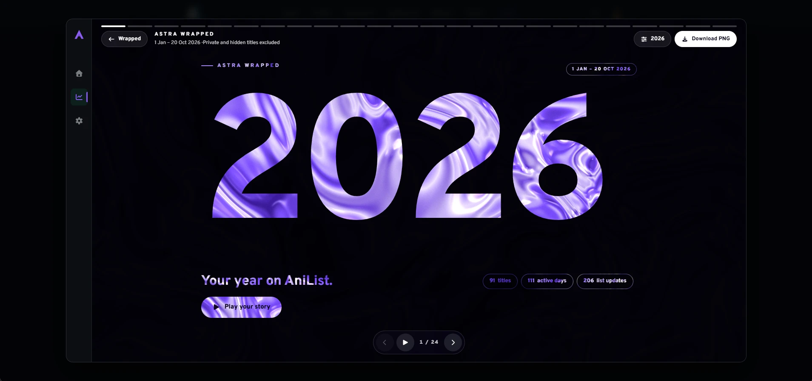
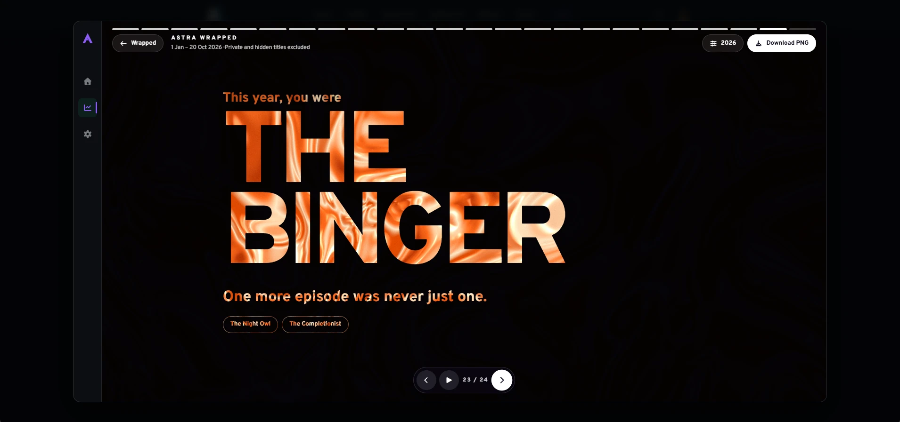
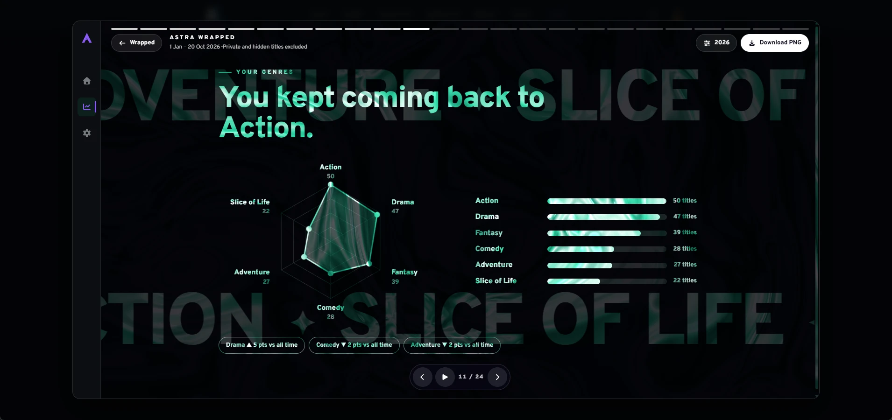
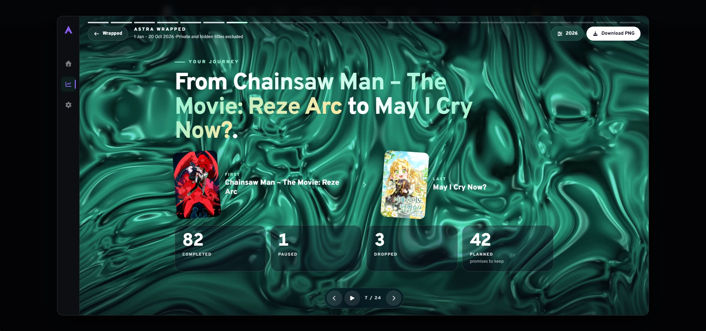

# AniList Ultimate (Unofficial)

An unofficial browser extension bringing a calendar, personal ratings, Wrapped recaps and social tools together for [AniList](https://anilist.co).

## Features

- **Calendar with social activity:** a customizable weekly anime airing calendar with countdowns, episode progress (watched/available/total), quick progress actions and friends' activity on each title.
- **Activity and profile filters:** filter or search activities on the home feed, user profiles and anime/manga Social pages; distinguish activity types and watching/reading states (including rewatches/rereads), and browse activity from selected custom user lists.
- **Reviews and ratings in activities:** show available users' media scores directly on supported list-activity cards and add review-score badges to supported review cards, including those appearing in feeds. Like and reply counts are preserved in extension-rendered activities. Scores only appear when the corresponding public AniList data exists and can be retrieved.
- **Forum navigation enhancements:** turn media-related forum-thread titles into direct links to the associated anime or manga, reducing unnecessary navigation.
- **Astra rating calculator:** calculate personal ratings from configurable scoring sections and weights; manage season ratings, tracked works, quick edits, a local Journal, AniList synchronization and JSON backups.
- **Astra Wrapped:** yearly, monthly or custom-period recaps of logged AniList list activity, including favorites, genres, studios and people, with downloadable PNG share cards.
- **Seasonal Wrapped:** broadcast-season rankings, personal awards, continuing titles and unfinished/leftover shows.
- **Custom user lists and list ordering:** create and edit your own groups of people for activity filtering, and choose and reorder the Following groups displayed on a title's Social and Overview sections. These local user groups are separate from AniList's native anime/manga custom lists.
- **Notifications:** search/filter and group compatible AniList notifications; Friend Alerts adds an independent local inbox for public progress/status updates from chosen people on titles you follow (not system push notifications).
- **Enhanced anime/manga pages:** add a Reddit/subreddit link, MyAnimeList (MAL) score and link when available, additional public metadata, review-score badges, and anime opening/ending music and theme links.
- **Episode counters and social context:** see friends' episode progress in a title's Following area, calendar episode counts, Following groups, available list Notes on hover and other social context.
- **Navigation and state restoration:** on supported Back/Forward navigation, recover the previous scroll position and loaded feed content; on anime/manga list pages also restore filters, search, sorting and list view where possible.
- **Bulk Editor:** select multiple entries on your own anime/manga lists and update statuses or AniList custom-list memberships with explicit save results.


**Modular by design:** individual feature modules can be enabled or disabled independently in the extension's settings, so you can tailor AniList Ultimate to your preferences. Some modules also offer their own additional controls. Account features use the extension's AniList OAuth login. The Bulk Editor works for every authenticated user on their own lists and stays inactive on other people's lists.

## Screenshots







## Installation

Requirements: **Node.js 22.13.0 or later**, npm and Chrome 120 or later. Edge and Brave can load unpacked extensions; browser-specific login behavior can vary.

```sh
git clone https://github.com/rikymarche-ctrl/anilist-ultimate.git
cd anilist-ultimate
npm ci
npm run build
```

Open `chrome://extensions/`, enable **Developer mode**, choose **Load unpacked**, and select the generated `dist/` folder. Reload AniList tabs, then log in through the extension popup.

Install AniList Ultimate from the [Chrome Web Store](https://chromewebstore.google.com/detail/anilist-ultimate/gogibdaaglfefnemakliohebmcjfdddo) after the listing is approved. Use the [installation guide](docs/INSTALLATION.md) for updates and independent builds.

## Guides

- [User guide](docs/USER_GUIDE.md)
- [Data, backups and recovery](docs/DATA_AND_BACKUPS.md)
- [Wrapped](docs/ASTRA_WRAPPED.md) and [Seasonal Wrapped](docs/SEASONAL_WRAPPED.md)
- [Friend Alerts](docs/FRIEND_ALERTS.md) and [Bulk Editor](docs/BULK_EDITOR.md)
- [Migration from the standalone extensions](docs/MIGRATION.md)
- [Troubleshooting](docs/TROUBLESHOOTING.md)
- [Complete documentation](docs/README.md)

Friend Alerts uses a local inbox, not system push notifications. Wrapped totals depend on available logged activity and metadata rather than measured playback history. Private/hidden titles start excluded from recaps.

## Data and privacy

Astra archives, account credentials, custom friend lists, alert state and pending edits are stored locally. Interface preferences use Chrome sync storage. Changes you request are sent to AniList; public metadata panels use additional services listed in the [privacy policy](PRIVACY.md).

Export your archive before uninstalling, switching installation identity or importing. Chrome preference sync does not back up Astra data. Downloaded backups and share cards stay on your device until you choose to share them.

## Development

TypeScript, Vite 7, Manifest V3 and tsyringe.

```sh
npm run check
npm run check:coverage
npm run smoke:mv3
npm run package
```

The browser smoke check requires a compatible Chromium runtime. Packaging consumes a fresh build and produces the store-upload ZIP under `release/`; distribution identity and OAuth must be configured for the intended installation.

See [contributing](CONTRIBUTING.md), [architecture](docs/ARCHITECTURE.md), [testing](docs/TESTING.md) and [OAuth setup](OAUTH_SETUP.md).

## License

[GNU GPL version 3](LICENSE). Third-party components retain their [own licenses and notices](THIRD_PARTY_NOTICES.md).

Created by **ExAstra**. AniList Ultimate brings together the earlier calendar and hover-comment extensions. It is not affiliated with or endorsed by AniList.

[Release notes](CHANGELOG.md) · [Support](https://github.com/rikymarche-ctrl/anilist-ultimate/issues) · [Security reporting](SECURITY.md)
