# AniList Ultimate (Unofficial)

An unofficial browser extension bringing a calendar, personal ratings, Wrapped recaps and social tools together for [AniList](https://anilist.co).

## Features

- **Calendar with social activity:** a customizable weekly anime airing calendar with countdowns, episode progress (watched/available/total), quick progress actions and friends' activity on each title.
- **Activity and profile filters:** filter or search activities on the home feed, user profiles and anime/manga Social pages; distinguish activity types and watching/reading states (including rewatches/rereads), and browse activity from selected custom user lists. With a custom list selected, or on your Following feed, a filter asks AniList for matching activity instead of only hiding rows, so a rare filter such as **Dropped** still fills the feed, with **Load More** reaching further back.
- **People in common:** on another user's profile, see how many people you follow also follow them or are followed by them, and how many of those are in your custom user lists; click a number to see who they are. Their Social tab also counts mutual followers, forum threads, forum comments and messages.
- **Reviews and ratings in activities:** show available users' media scores right after the title on supported list-activity cards and add review-score badges to supported review cards, including those appearing in feeds. Like and reply counts are preserved in extension-rendered activities. Scores only appear when the corresponding public AniList data exists and can be retrieved.
- **Forum navigation enhancements:** turn media-related forum-thread titles into direct links to the associated anime or manga, reducing unnecessary navigation.
- **Astra rating calculator:** calculate personal ratings from configurable scoring sections and weights; manage season ratings, tracked works, quick edits with a one-click Revert, a local Journal, AniList synchronization and JSON backups.
- **Astra Wrapped:** yearly, monthly or custom-period recaps of logged AniList list activity, including favorites, genres, studios and people, with downloadable PNG share cards.
- **Seasonal Wrapped:** broadcast-season rankings, personal awards, continuing titles and unfinished/leftover shows.
- **Custom user lists and list ordering:** create and edit your own groups of people for activity filtering, and choose and reorder the Following groups displayed on a title's Social and Overview sections. These local user groups are separate from AniList's native anime/manga custom lists.
- **Notifications:** search/filter and group compatible AniList notifications; Friend Alerts adds an independent local inbox for public progress/status updates from chosen people on titles you follow (not system push notifications).
- **Enhanced anime/manga pages:** add a Reddit/subreddit link, MyAnimeList (MAL) score and link when available, additional public metadata, review-score badges, and anime opening/ending music and theme links.
- **Episode counters and social context:** see friends' episode progress in a title's Following area, calendar episode counts, Following groups, available list Notes on hover and other social context.
- **Navigation and state restoration:** on supported Back/Forward navigation, recover the previous scroll position and loaded feed content; on anime/manga list pages also restore filters, search, sorting and list view where possible.
- **Bulk Editor:** select multiple entries on your own anime/manga lists and update statuses or AniList custom-list memberships with explicit save results.


**Modular by design:** individual feature modules can be enabled or disabled independently in the extension's settings, so you can tailor AniList Ultimate to your preferences. Some modules also offer their own additional controls. Account features use the extension's AniList OAuth login. The Bulk Editor works for every authenticated user on their own lists and stays inactive on other people's lists.

## Screenshots

### Calendar and social activity

A weekly airing calendar with episode progress and in-progress anime and manga, with friends' activity for each title.

**AU Calendar** — weekly airing schedule and in-progress lists.

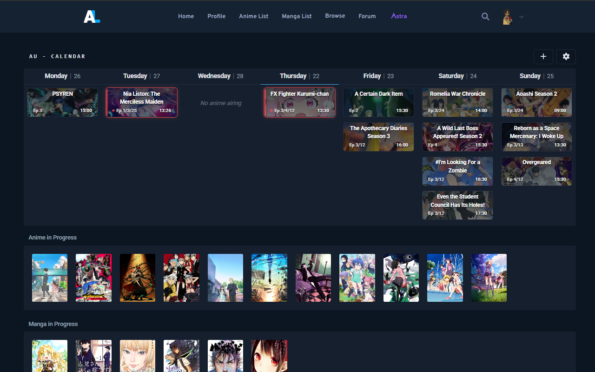

**Calendar + Social Activity** — friends' activity, progress and scores alongside the calendar.

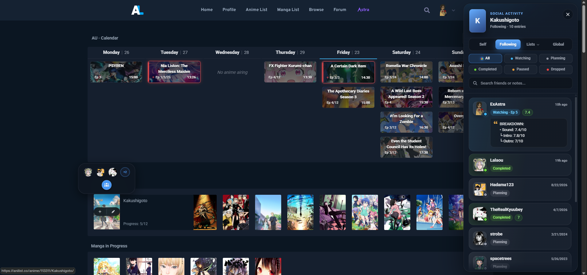

### Activity filters, reviews and ratings

Filter activity by type or search by user, content or title. Review cards show available scores alongside the feed.

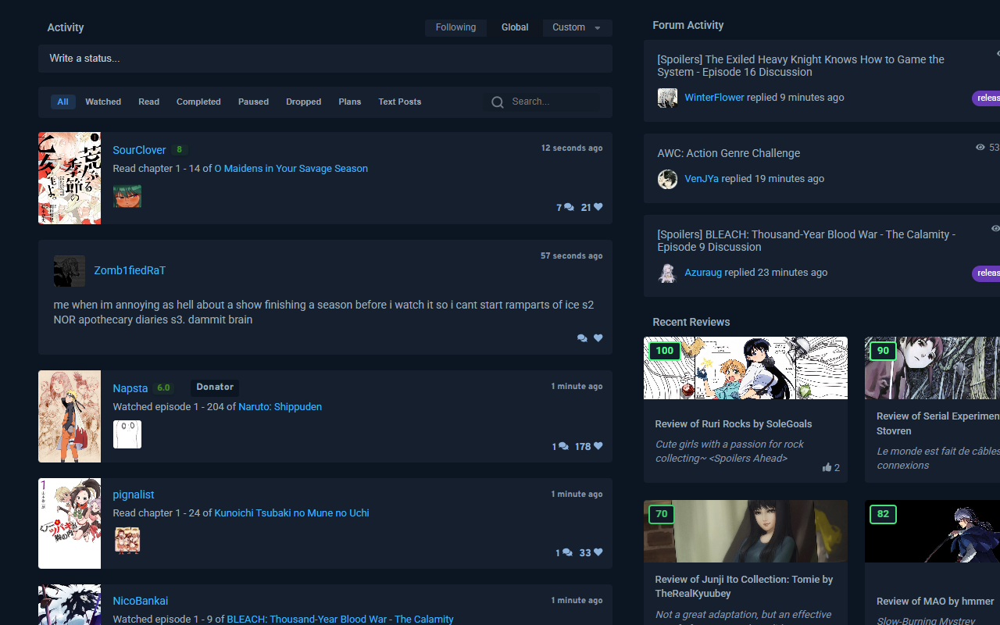

### People in common

Open someone's profile to see the people you share with them: how many of the people you follow also follow them or are followed by them, and how many of those are in your custom user lists. Click a number to see who they are, with a search box for long lists. The profile's Social tab adds counts for mutual followers, forum threads, forum comments and messages.

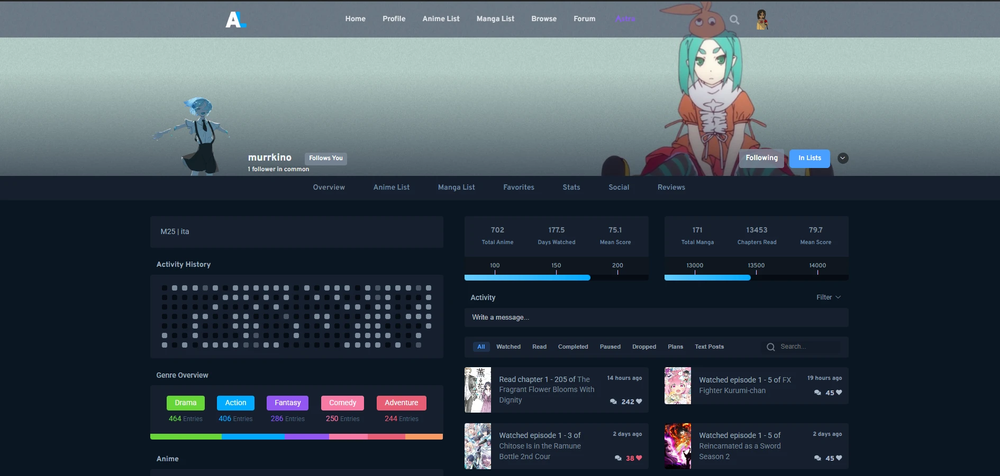

### Custom user lists and Following groups

Create and manage your own groups of AniList users—for example, **Best Friends** and **Notable ones**—and use them as activity feeds of their own. A custom feed looks like AniList's own feed: text posts keep their formatting, spoilers and videos, and likes, replies and links work as usual. These groups belong to AniList Ultimate, not AniList's native anime/manga custom lists.

You can also select which groups appear in the **Following** column on an anime or manga's Social tab. Members of each selected list are displayed together under its name, in your chosen order; everyone not in a selected group appears under **Others**. This changes the presentation only, not your AniList account or follow relationships.

**Custom User Lists settings** — create groups, manage their members and choose which ones to display in Following. While managing a list, click a user's card to add or remove them, or click their avatar to open their AniList profile in a new tab.

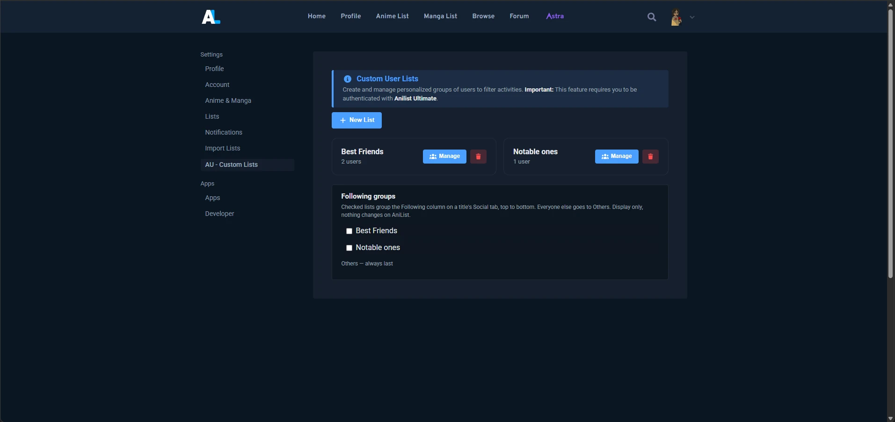

**See it in action:** in the [anime Social page screenshot](docs/screenshots/work-title-page-social-enhancements.webp) below, the **Best Friends** section illustrates how members of that custom list are separated from the rest of the Following column.

### Enriched anime and manga pages

See media links and metadata, episode counts, staff, themes, score distribution, trailer and friends' progress on title pages.

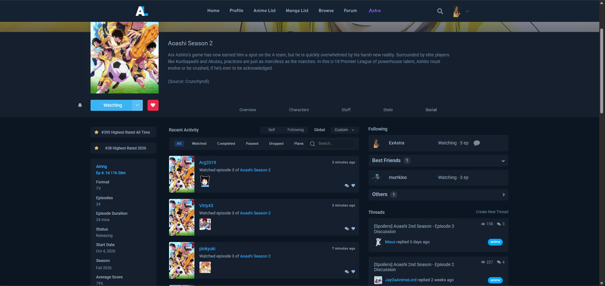

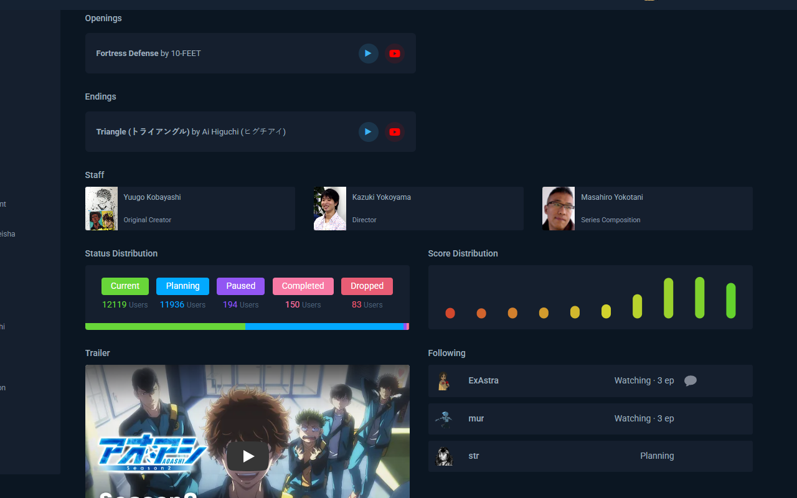

### Notifications and friend alerts

Search and filter AniList notifications, review friend activity in the local inbox, and choose which friends to follow for alerts on a title.

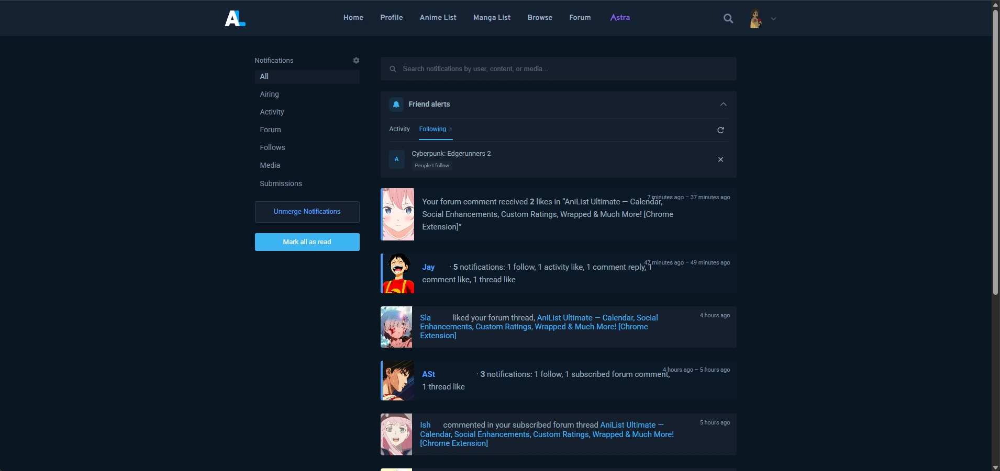

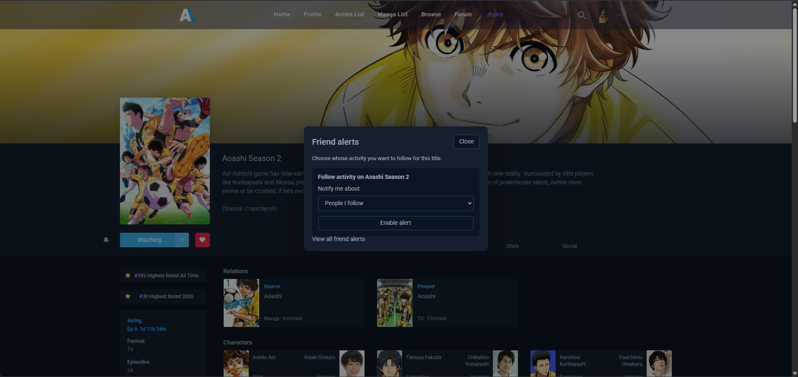

### Astra dashboard and ratings

Organize anime and manga, track progress and rate titles using configurable scoring sections.

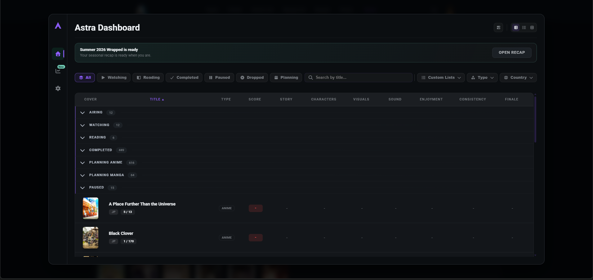

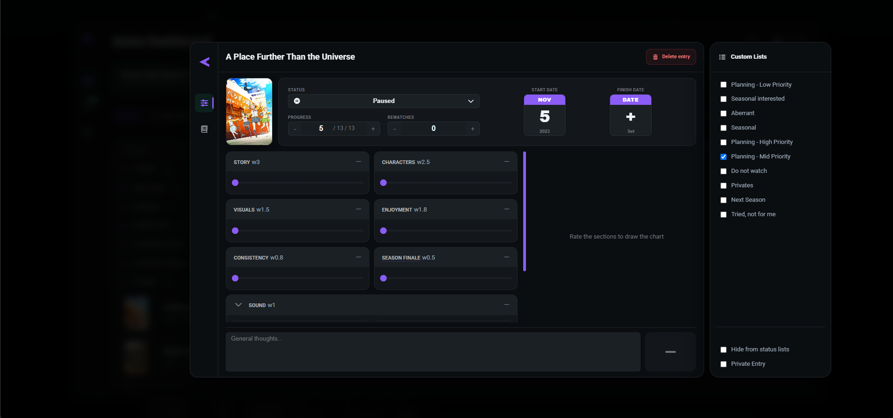

### Astra Wrapped

Explore a personal recap and shareable yearly highlights, including favorite voice actors and their characters.

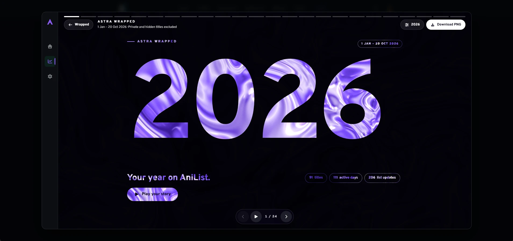


### Bulk Editor

Select multiple list entries and update them together.

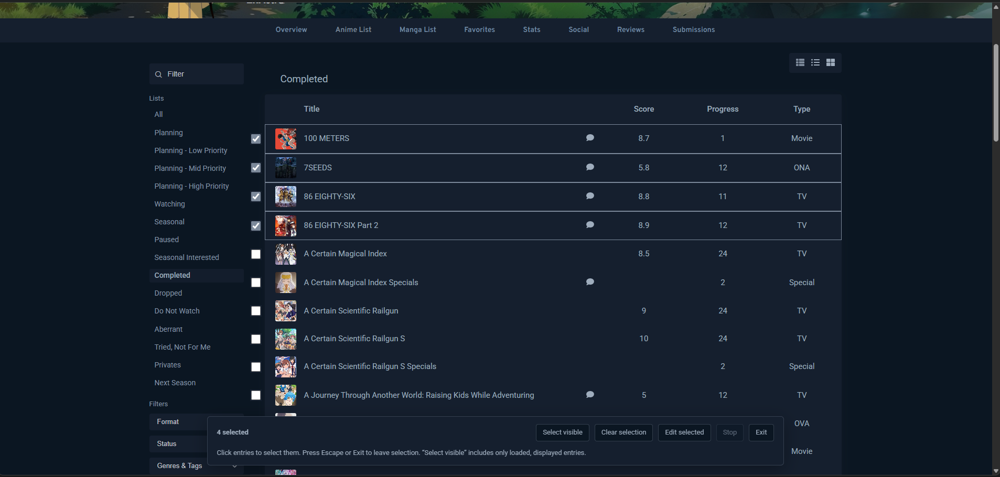

### Feature module settings

Enable or disable feature modules independently from the extension's control panel.

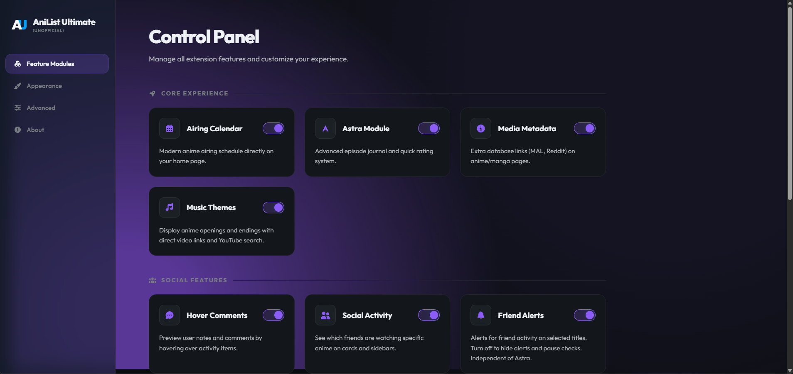

## Installation

Requirements: **Node.js 22.13.0 or later**, npm and Chrome 120 or later (or Firefox 140 or later, see below). Edge and Brave can load unpacked extensions; browser-specific login behavior can vary.

```sh
git clone https://github.com/rikymarche-ctrl/anilist-ultimate.git
cd anilist-ultimate
npm ci
npm run build
```

Open `chrome://extensions/`, enable **Developer mode**, choose **Load unpacked**, and select the generated `dist/` folder. Reload AniList tabs, then log in through the extension popup.

Install AniList Ultimate from the [Chrome Web Store](https://chromewebstore.google.com/detail/anilist-ultimate/gogibdaaglfefnemakliohebmcjfdddo) after the listing is approved. Use the [installation guide](docs/INSTALLATION.md) for updates and independent builds.

### Firefox

Firefox 140 or later is supported. A Firefox build needs its own AniList OAuth client: see [OAuth setup](OAUTH_SETUP.md#firefox-build).

```sh
npm run build:firefox
```

Open `about:debugging#/runtime/this-firefox`, choose **Load Temporary Add-on** and select `dist-firefox/manifest.json`. The Firefox listing on addons.mozilla.org follows once it is approved.

## Guides

- [User guide](docs/USER_GUIDE.md)
- [Data, backups and recovery](docs/DATA_AND_BACKUPS.md)
- [Wrapped](docs/ASTRA_WRAPPED.md) and [Seasonal Wrapped](docs/SEASONAL_WRAPPED.md)
- [Friend Alerts](docs/FRIEND_ALERTS.md) and [Bulk Editor](docs/BULK_EDITOR.md)
- [Migration from the standalone extensions](docs/MIGRATION.md)
- [Troubleshooting](docs/TROUBLESHOOTING.md)
- [Complete documentation](docs/README.md)

Friend Alerts uses a local inbox, not system push notifications. Wrapped totals depend on available logged activity and metadata rather than measured playback history. Private/hidden titles start excluded from recaps.

## Data and privacy

Astra archives, account credentials, custom friend lists, alert state and pending edits are stored locally. Interface preferences use Chrome sync storage. Changes you request are sent to AniList; public metadata panels use additional services listed in the [privacy policy](PRIVACY.md).

Export your archive before uninstalling, switching installation identity or importing. Chrome preference sync does not back up Astra data. Downloaded backups and share cards stay on your device until you choose to share them.

## Development

TypeScript, Vite 7, Manifest V3 and tsyringe.

```sh
npm run check
npm run check:coverage
npm run smoke:mv3
npm run package
npm run release
```

The browser smoke check requires a compatible Chromium runtime. Packaging consumes a fresh build and produces the store-upload ZIP under `release/`; `npm run release` builds and packages both the Chrome and Firefox archives; distribution identity and OAuth must be configured for the intended installation.

See [contributing](CONTRIBUTING.md), [architecture](docs/ARCHITECTURE.md), [testing](docs/TESTING.md) and [OAuth setup](OAUTH_SETUP.md).

## License

[GNU GPL version 3](LICENSE). Third-party components retain their [own licenses and notices](THIRD_PARTY_NOTICES.md).

Created by **ExAstra**. AniList Ultimate brings together the earlier calendar and hover-comment extensions. It is not affiliated with or endorsed by AniList.

[Release notes](CHANGELOG.md) · [Support](https://github.com/rikymarche-ctrl/anilist-ultimate/issues) · [Security reporting](SECURITY.md)
